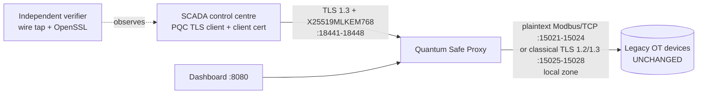

# Quantum Safe Proxy for Energy OT (local demo, mock data)

**Story:** Energy-sector OT systems (RTUs, turbine controllers, flow computers, dam gates) must expose
post-quantum-safe communications, but their 2005-2011 firmware cannot be updated. The Quantum Safe Proxy (QSP)
terminates **TLS 1.3 with hybrid ML-KEM key exchange (X25519MLKEM768)** in front of them and talks plaintext
Modbus/TCP to the **unchanged** device. The IT admin onboards an asset in one click and the dashboard *proves*
the PQC protocol from independent evidence.

The catalogue has **8 legacy assets in two groups**: 4 that speak **plaintext** Modbus/TCP (2005-2011 firmware) and
4 that already use **classical, non-PQC TLS** (TLS 1.2 ECDHE P-256/P-384 and TLS 1.3 X25519/P-256, RSA-2048 device
certificate, 2014-2017 firmware). Both groups are onboarded and proven the same way; for the TLS group the proxy talks
to the unchanged device with its own classical TLS and the proof shows the classical group on the wire before and
`X25519MLKEM768` after.

Everything is mock data and runs on `127.0.0.1` only. No npm dependencies.
https://github.com/ncee-dp-tech-sme/quantumsafeproxydemo


## Requirements
- Node.js >= 24 and **OpenSSL >= 3.5** (ML-KEM). Verified with Node 26 / OpenSSL 4.1 on macOS. Bash or zsh.

## Run
```bash
npm run demo        # creates .env + demo certificates, starts mock legacy devices and the proxy
open http://127.0.0.1:8080
npm test            # 11 unit/integration/security tests (uses other ports, safe while the demo runs)
npm run stop        # stop everything;  npm run reset  -> forget onboarded assets (fresh demo)
```
Sysadmin CLI (same API as the UI): `npm run cli -- list | onboard SUB-RTU-01 | verify SUB-RTU-01 | rollback SUB-RTU-01`

## Demo script (about 5 minutes)
1. **IT Admin tab** - 8 legacy assets: 4 red "Plaintext · no PQC" and 4 amber "TLS 1.2 / TLS 1.3 · no PQC". KPI: 0/8 protected.
   Optional: `echo Q | openssl s_client -connect 127.0.0.1:15021 -tls1_3` fails (no TLS at all);
   `echo Q | openssl s_client -connect 127.0.0.1:15025 -tls1_2 -CAfile certs/ca.pem` succeeds with classical ECDHE (no ML-KEM),
   and `... :15025 -tls1_3 -groups X25519MLKEM768` is refused.
2. Select *Substation Alpha RTU*, click **Onboard**. Steps stream in (fingerprint device, baseline scan fails as
   expected, open PQC listener, smoke test, independent verification) - about 0.2 s.
3. **WOW panel** - banner "now uses post-quantum key exchange: X25519MLKEM768", with:
   - *0* firmware / config / restart / software / device-port changes, device fingerprint identical before and after;
   - for the TLS devices the *Before* card shows the classical group seen on the wire (e.g. `secp256r1` in a TLS 1.2
     ServerKeyExchange, `x25519` in a TLS 1.3 ServerHello) and the verification adds a check that the legacy endpoint is classical-only;
   - **Before vs After on the wire**: cleartext Modbus with the device identity readable, versus a TLS 1.3 ServerHello
     whose `key_share` is group `0x11ec` (X25519MLKEM768) with a 1120-byte ML-KEM share, then only encrypted records;
   - live OT readings still flowing through the PQC channel;
   - 10 independent checks, including negative tests: classical-only (X25519) client, TLS 1.2 client, client without
     certificate and plaintext Modbus on the PQC port are all refused.
4. Click **Roll back** to show the change is reversible (device untouched), then onboard again.
5. **CTO / CFO tab** - coverage ring, rip-and-replace vs proxy (mock figures in `data/economics.json`).
6. **Compliance tab** - evidence table with SHA-256 per verification, enforced policy, **printable report** (`/api/report`).

## How the proof works (does not trust the proxy's own claims)
| Evidence | How |
|---|---|
| Wire capture | Transparent TCP tap records the handshake; ClientHello/ServerHello are parsed for the negotiated group and key-share size |
| Independent client | Stock `openssl s_client` reports `Negotiated TLS1.3 group: X25519MLKEM768` |
| Negative tests | Classical-only, TLS 1.2, no client cert, plaintext - all rejected |
| Data parity | Same registers via PQC channel and directly from the device |
| Device untouched | Device identity/config fingerprint (Modbus FC 0x11) identical before and after |
| Tamper evidence | Each result stored in `evidence/` with SHA-256 |

## Layout
`src/legacy/ot-simulator.js` mock old devices (plaintext Modbus, or Modbus over classical TLS when `legacyTransport` is set in `data/assets.json`) · `src/proxy/qsp.js` PQC proxy + onboarding ·
`src/proxy/server.js` admin API, dashboard host, report · `src/lib/verifier.js` independent verification ·
`ui/` dashboard (CSP-safe, no inline script/style) · `data/assets.json`, `data/economics.json` mock data ·
`scripts/gen-certs.sh` demo PKI (30 days, rotates automatically, old set backed up to `certs.bak-*`) · `tests/`.

## Configuration (`.env`, see `.env.example`)
`LOG_LEVEL`, `QSP_ADMIN_PORT`, `QSP_ALLOWED_GROUPS`, `QSP_REQUIRE_CLIENT_CERT`, `QSP_CERT_DIR`, timeouts, `OPENSSL_BIN`.
Binding to `0.0.0.0` is refused by the config loader.

## Security notes and honest scope
- Protects data **in transit** against harvest-now-decrypt-later with hybrid ML-KEM. Certificate **signatures are
  classical ECDSA** in this demo; PQC signatures (ML-DSA) are roadmap.
- The proxy-to-device hop is plaintext (or the device's own classical TLS) by design (legacy limitation): keep proxy and device in the same secured zone.
- Mutual TLS, TLS 1.3 only, AES-256-GCM, loopback binding, idle/upstream timeouts, structured JSON logs and audit trail
  (`logs/audit.log`, no secrets logged), generic errors to clients.
- Admin API/dashboard: loopback only, Host allowlist, custom header + Origin check against CSRF/DNS rebinding, strict CSP.
  **It has no user login** (demo from source on a laptop). Before any real deployment add SAML/OIDC + RBAC + MFA.
- Demo keys in `certs/` are generated locally and git-ignored. In production use a real CA/HSM and rotation.
- Costs, devices, readings and regulatory mappings are illustrative mock data, not advice.
- Not run in a container here; if you containerise, use a Red Hat UBI minimal Node image, non-root user, read-only FS.
